# Day 08 – React.js Fundamentals: Company Portfolio SPA

**ApexLark Full Stack Development Internship · Task Day 8**
Topic: React.js Fundamentals – Components, JSX, Props & State

**Skyloom Labs** is a fictional startup that is moving its static website to a modern React Single Page Application. This project rebuilds that site with **React 19 + Vite**, using reusable functional components, props, conditional rendering and the `useState` hook.

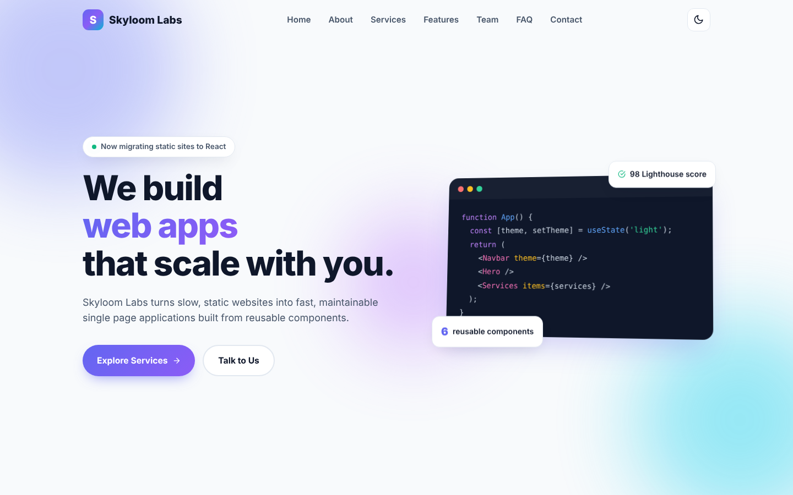

---

## Table of Contents

1. [Tech Stack](#tech-stack)
2. [Getting Started](#getting-started)
3. [Project Structure](#project-structure)
4. [Task Requirements Checklist](#task-requirements-checklist)
5. [Component Architecture](#component-architecture)
6. [JSX, Props & Lists](#jsx-props--lists)
7. [State Management (useState)](#state-management-usestate)
8. [Additional Features](#additional-features)
9. [Responsive Design & Styling](#responsive-design--styling)
10. [Screenshots](#screenshots)
11. [Learning Outcomes](#learning-outcomes)

---

## Tech Stack

| Tool | Purpose |
| --- | --- |
| React 19 | UI library – functional components and hooks |
| Vite 7 | Dev server and production build |
| JavaScript (ES6+) | Arrow functions, destructuring, spread, template literals, modules |
| HTML5 / CSS3 | Semantic markup, Flexbox, Grid, custom properties, keyframe animations |
| react-icons | Feather icon set |
| Git & GitHub | Version control and hosting |

---

## Getting Started

**Requirements:** Node.js 20.19+ (or 22.12+) and npm.

```bash
# 1. Clone the repository
git clone https://github.com/<your-username>/Day-08-React-Fundamentals.git
cd Day-08-React-Fundamentals

# 2. Install dependencies
npm install

# 3. Start the development server
npm run dev          # opens on http://localhost:5173

# 4. Production build (optional)
npm run build
npm run preview
```

---

## Project Structure

```
Day-08-React-Fundamentals/
│
├── public/
│   └── favicon.svg
├── screenshots/                 # application screenshots (desktop, tablet, mobile)
├── src/
│   ├── components/
│   │   ├── Navbar.jsx           # navigation + mobile menu + theme button
│   │   ├── Hero.jsx             # animated hero section
│   │   ├── About.jsx            # company introduction
│   │   ├── Stats.jsx            # animated statistics counter
│   │   ├── Services.jsx         # services section with filter tabs
│   │   ├── ServiceCard.jsx      # reusable service card (details toggle)
│   │   ├── Features.jsx         # features section
│   │   ├── FeatureCard.jsx      # reusable feature card
│   │   ├── Team.jsx             # team section
│   │   ├── TeamCard.jsx         # reusable team member card
│   │   ├── TeamModal.jsx        # team member profile modal
│   │   ├── FAQ.jsx              # FAQ accordion
│   │   ├── Contact.jsx          # controlled contact form
│   │   ├── ContactInfoCard.jsx  # reusable contact info card
│   │   ├── Footer.jsx           # footer
│   │   ├── ScrollToTop.jsx      # scroll-to-top button with progress ring
│   │   └── SectionHeader.jsx    # reusable section heading
│   ├── data/
│   │   └── siteData.js          # all content (passed to components as props)
│   ├── styles/
│   │   └── style.css            # global, responsive styles + light/dark themes
│   ├── App.jsx                  # root component, theme state, layout
│   └── main.jsx                 # React entry point
├── index.html
├── vite.config.js
├── package.json
└── README.md
```

---

## Task Requirements Checklist

| # | Requirement | Status | Where |
| --- | --- | :---: | --- |
| 1 | Vite project with required folder structure | ✅ | see above |
| 2 | Separate functional components: Navbar, Hero, About, Services, Features, Team, Contact, Footer | ✅ | `src/components/` |
| 3 | Lists rendered with `.map()` | ✅ | nav links, services, features, team, FAQ, contact info, footer, stats |
| 3 | Conditional rendering | ✅ | Popular badge, details panel, modal, form errors / success, empty state, theme icon |
| 3 | Data passed via props to reusable cards (Services, Team, Features, Contact Info) | ✅ | `ServiceCard`, `TeamCard`, `FeatureCard`, `ContactInfoCard` |
| 4 | `useState` – Mobile Navigation Toggle | ✅ | `Navbar.jsx` |
| 4 | `useState` – Theme Switcher (Dark/Light) | ✅ | `App.jsx` |
| 4 | `useState` – Service Details Toggle | ✅ | `Services.jsx` / `ServiceCard.jsx` |
| 4 | `useState` – Controlled Contact Form | ✅ | `Contact.jsx` |
| 4 | Button clicks, form submission, menu toggles | ✅ | throughout |
| 5 | Responsive CSS with Flexbox / Grid (mobile, tablet, desktop) | ✅ | `style.css` |
| 5 | Smooth animations and hover effects | ✅ | `style.css` |
| 5 | Animated Hero | ✅ | `Hero.jsx` |
| 5 | Dynamic Stats Counter | ✅ | `Stats.jsx` |
| 5 | FAQ Accordion | ✅ | `FAQ.jsx` |
| 5 | Team Modal | ✅ | `TeamModal.jsx` |
| 5 | Scroll-to-Top | ✅ | `ScrollToTop.jsx` |
| – | README documentation + screenshots | ✅ | this file, `screenshots/` |

---

## Component Architecture

```
App  (theme state)
├── Navbar            props: brand, links, theme, onToggleTheme      state: menuOpen, scrolled
├── main
│   ├── Hero          props: eyebrow, rotatingWords, subtitle, CTAs  state: wordIndex
│   ├── About         props: title, description, points, highlight
│   ├── Stats         props: items                                   state: visible
│   │   └── StatCounter × 4                                          state: count
│   ├── Services      props: items, categories                       state: expandedId, activeCategory
│   │   └── ServiceCard × n   props: service, isExpanded, onToggle
│   ├── Features      props: items
│   │   └── FeatureCard × n   props: icon, title, text, index
│   ├── Team          props: members                                 state: selectedMember
│   │   ├── TeamCard × n      props: member, onSelect
│   │   └── TeamModal         props: member, onClose  (only when a member is selected)
│   ├── FAQ           props: items                                   state: openId
│   └── Contact       props: info                                    state: formData, errors, status
│       └── ContactInfoCard × n  props: icon, label, value, href
├── Footer            props: company, columns, socials
└── ScrollToTop                                                      state: visible, progress
```

**Data flows down, events flow up:**
- All content lives in `src/data/siteData.js`. `App` imports it and passes it down as props, so components contain no hard-coded content.
- Child cards never change state directly. They call callback props (`onToggle`, `onSelect`, `onToggleTheme`, `onClose`), and the parent that owns the state updates it.
- `SectionHeader` is reused by every section for a consistent heading.

---

## JSX, Props & Lists

**Rendering a list with `.map()` and a stable `key`:**

```jsx
{visibleServices.map((service) => (
  <ServiceCard
    key={service.id}
    service={service}
    isExpanded={expandedId === service.id}
    onToggle={handleToggle}
  />
))}
```

**Destructuring props, including renaming a component prop:**

```jsx
export default function FeatureCard({ icon: Icon, title, text, index }) {
  return (
    <article className="card feature-card" style={{ '--i': index }}>
      <div className="card__icon card__icon--soft"><Icon /></div>
      <h3 className="card__title">{title}</h3>
      <p className="card__text">{text}</p>
    </article>
  );
}
```

**Conditional rendering patterns used:**

| Pattern | Example |
| --- | --- |
| `&&` | `{popular && <span className="badge">Popular</span>}` |
| Ternary | `{theme === 'light' ? <FiMoon /> : <FiSun />}` |
| Ternary for whole views | Contact form ↔ success message |
| `&&` for mounting a component | `{selectedMember && <TeamModal ... />}` |
| Empty state | `visibleServices.length > 0 ? grid : <p>No services…</p>` |

---

## State Management (useState)

### 1. Mobile Navigation Toggle – `Navbar.jsx`
```jsx
const [menuOpen, setMenuOpen] = useState(false);
const toggleMenu = () => setMenuOpen((open) => !open);
```
- The hamburger button switches between ☰ and ✕ icons and slides in a side drawer.
- Clicking a link, the dark backdrop, or resizing to desktop closes the menu.
- `aria-expanded` and `aria-controls` keep it accessible.

### 2. Theme Switcher (Dark / Light) – `App.jsx`
```jsx
const [theme, setTheme] = useState(getInitialTheme);
useEffect(() => {
  document.documentElement.setAttribute('data-theme', theme);
  localStorage.setItem('skyloom-theme', theme);
}, [theme]);
```
- State lives in `App` and is passed to `Navbar` as `theme` + `onToggleTheme` (lifting state up).
- Colours are CSS custom properties. `[data-theme='dark']` overrides them, so the whole site switches with one attribute.
- The choice is saved in `localStorage`. On the first visit the app follows the operating system's preference.

### 3. Service Details Toggle – `Services.jsx` + `ServiceCard.jsx`
```jsx
const [expandedId, setExpandedId] = useState(null);
const handleToggle = (id) => setExpandedId((current) => (current === id ? null : id));
```
- Only one card is open at a time (accordion behaviour).
- The details panel animates open with a CSS `grid-template-rows: 0fr → 1fr` transition.
- **Bonus:** a second state, `activeCategory`, filters services by *All / Development / Design / Cloud*.

### 4. Controlled Contact Form – `Contact.jsx`
```jsx
const [formData, setFormData] = useState({ name: '', email: '', subject: '', message: '' });

const handleChange = (e) => {
  const { name, value } = e.target;
  setFormData((prev) => ({ ...prev, [name]: value }));
};
```
- Every input's `value` comes from state, and one `handleChange` updates any field through its `name` attribute.
- `handleSubmit` calls `e.preventDefault()`, validates all fields (required fields, email format, message of at least 10 characters) and shows inline error messages.
- A simulated API call shows a spinner (`status: 'sending'`), then a personalised success message, and resets the form.
- A live character counter shows `n / 500`.

---

## Additional Features

| # | Feature | How it works |
| --- | --- | --- |
| 1 | **Animated Hero** | Three blurred gradient blobs float with CSS `@keyframes`. A headline word rotates every 2.2 s (`useState` + `setInterval`, cleaned up in `useEffect`). Changing the `key` remounts the word so its entrance animation replays. Content fades up in a staggered sequence, and the code window tilts in 3D on hover. |
| 2 | **Dynamic Stats Counter** | An `IntersectionObserver` sets `visible` when the stats band scrolls into view. Each `StatCounter` then counts from 0 to its target with `requestAnimationFrame` and an ease-out curve. It runs only once. |
| 3 | **FAQ Accordion** | `openId` state keeps one answer open at a time. The plus icon rotates into an ✕, and the panel height animates smoothly. Uses `aria-expanded`, `aria-controls` and `role="region"`. |
| 4 | **Team Modal** | Clicking a team card stores that member in `selectedMember`, which mounts `TeamModal`. The modal closes with the ✕ button, the **Escape** key, or a click outside. Background scrolling is locked while it is open, and focus moves to the close button. |
| 5 | **Scroll-to-Top** | Appears after 400 px of scrolling. A conic-gradient ring shows how far down the page you are, and clicking it smooth-scrolls back to the top. |
| + | Extras | Service category filter, sticky navbar with blur on scroll, form validation with a loading spinner, theme saved in `localStorage`, `prefers-reduced-motion` support. |

---

## Responsive Design & Styling

- **Mobile-first CSS** with three breakpoints:
  | Viewport | Width | Layout |
  | --- | --- | --- |
  | Desktop | > 1024 px | 3-column services/features, 4-column team, 2-column hero |
  | Tablet | 601 – 1024 px | 2-column grids. Hamburger menu at ≤ 900 px. Hero stacks. |
  | Mobile | ≤ 600 px | Single column, stacked form fields, compact cards |
- **Flexbox** for the navbar, buttons, cards, chips and footer bottom bar. **CSS Grid** for every card grid, the hero, the about section, stats, the contact layout and the footer.
- **Hover effects:** cards lift and glow, icons tilt, nav links get an animated underline, buttons rise, and socials and contact cards slide.
- **Animations:** fade-up entrances, floating blobs, a pulsing status dot, the rotating hero word, modal pop-in, the spinner and smooth collapse transitions.
- **Accessibility:** semantic landmarks, `aria-*` attributes on all toggles, visible focus outlines, labelled form fields and reduced-motion support.

---

## Screenshots

### Desktop – Light & Dark Theme
| Light | Dark |
| --- | --- |
|  | 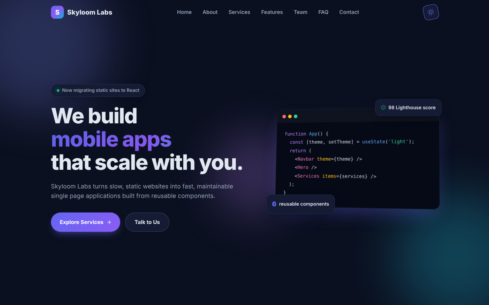 |

<details>
<summary>Full-page screenshots</summary>

| Light | Dark |
| --- | --- |
| 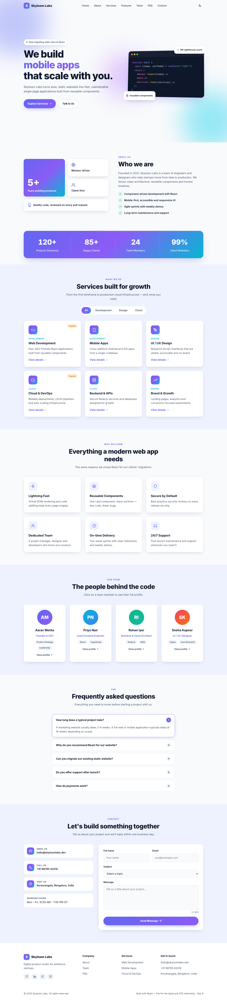 | 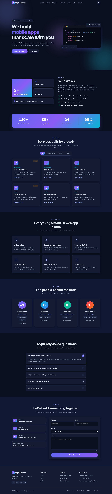 |

</details>

### About & Dynamic Stats Counter
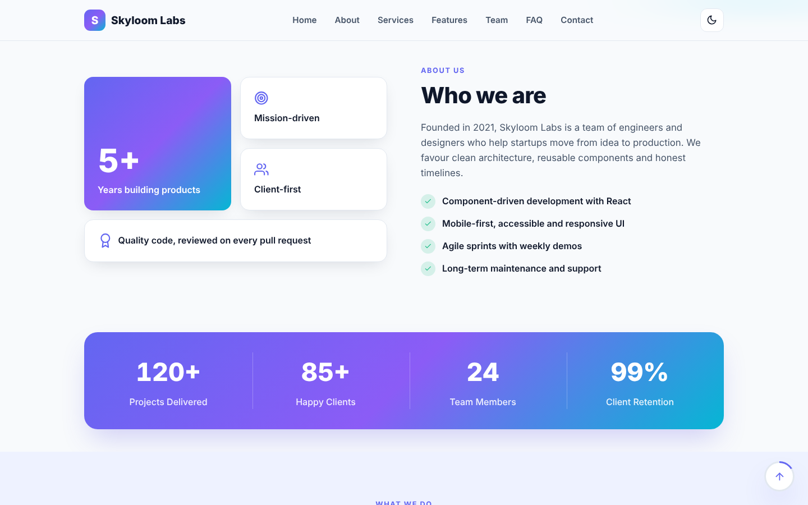

### Services – Details Toggle & Category Filter
| Details expanded | Filtered: Cloud |
| --- | --- |
| 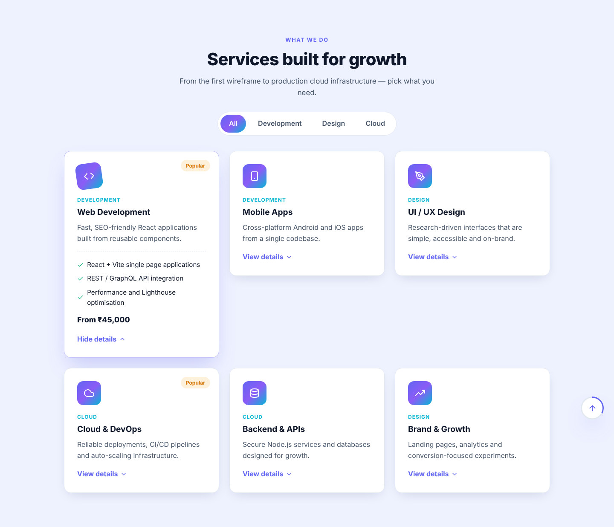 | 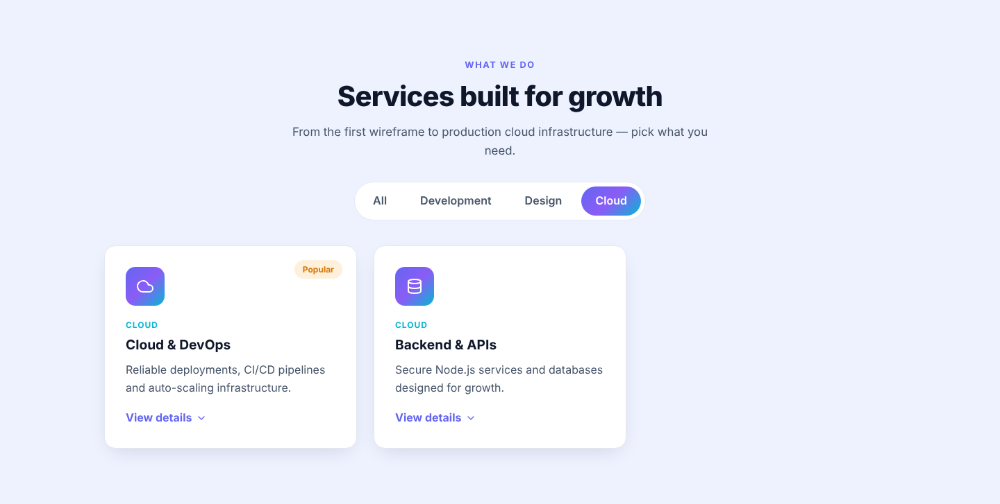 |

### Features
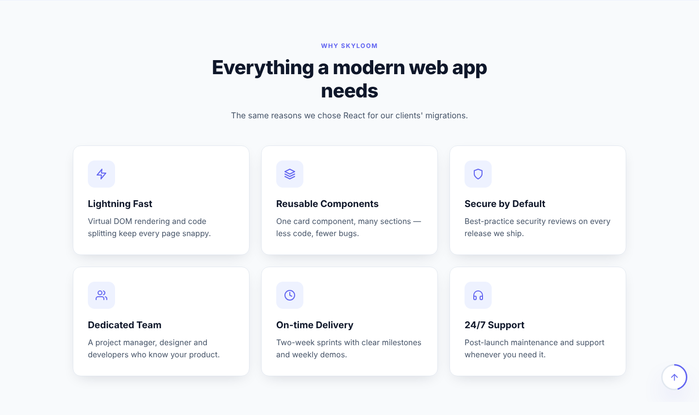

### Team Modal
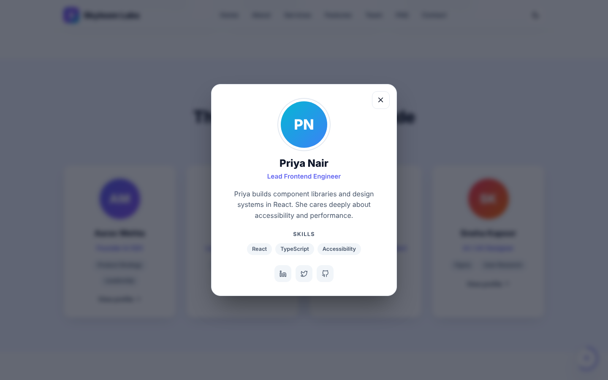

### FAQ Accordion
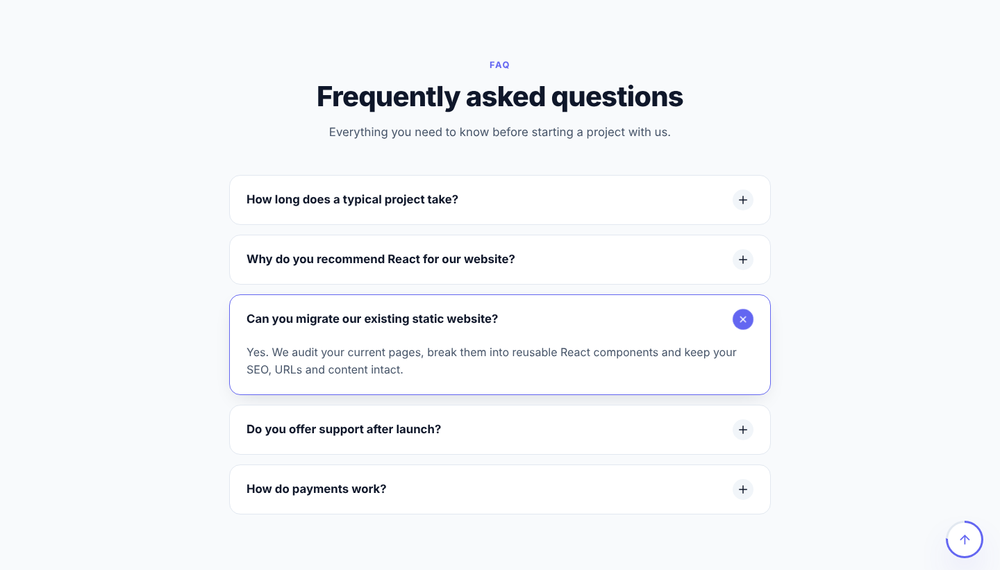

### Controlled Contact Form
| Validation | Sending | Success |
| --- | --- | --- |
| 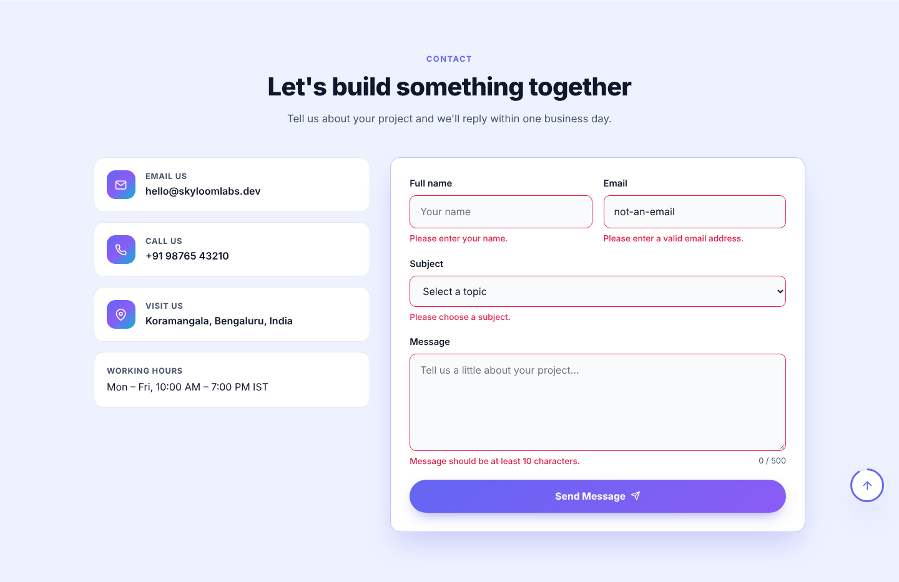 | 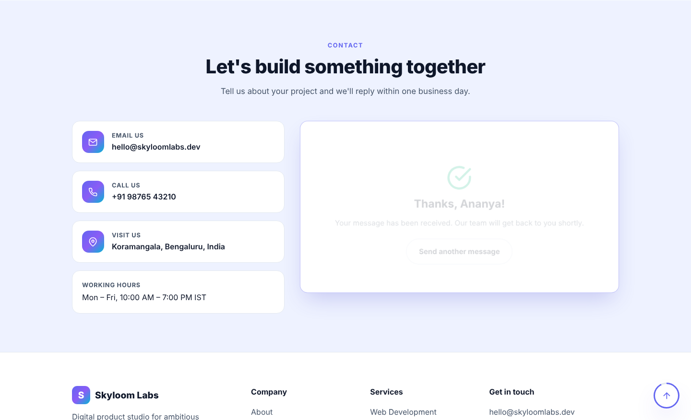 | 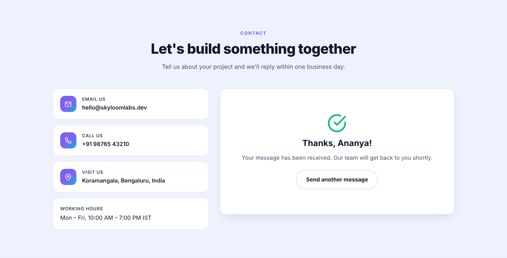 |

### Footer & Scroll-to-Top
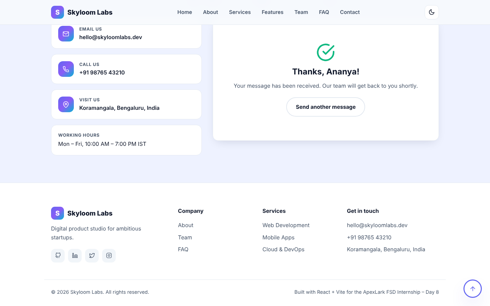

### Tablet & Mobile
| Tablet (820 px) | Mobile (390 px) | Mobile menu open | Mobile services |
| --- | --- | --- | --- |
| 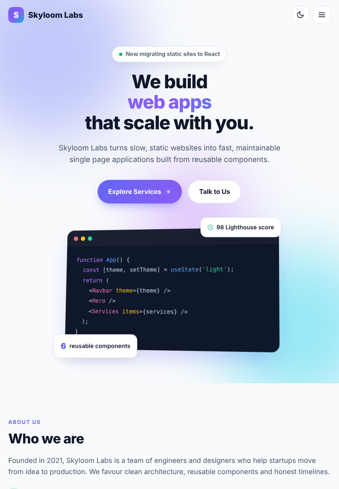 | 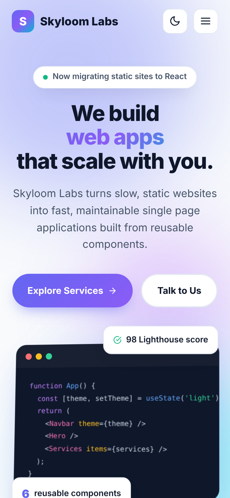 | 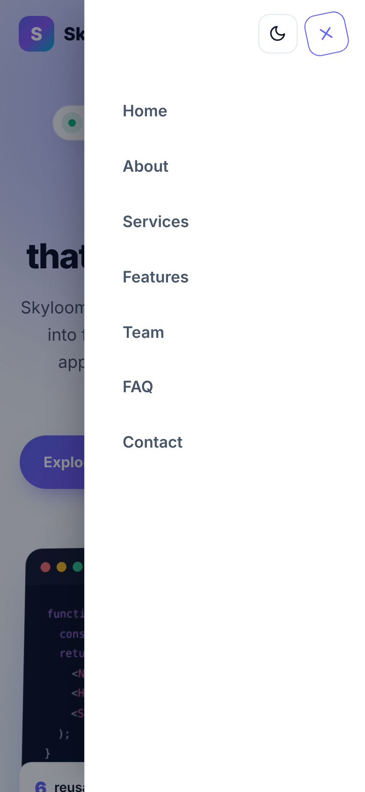 | 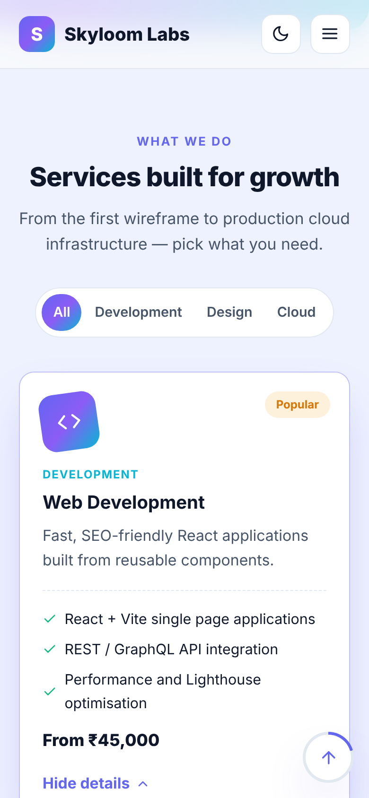 |

---

## Learning Outcomes

- Broke a static page into **small, reusable functional components** with a clear parent → child data flow.
- Used **JSX** expressions, `.map()` with keys, and several **conditional rendering** patterns.
- Passed data and callbacks through **props**, and **lifted state up** (theme) when siblings needed it.
- Managed UI state with **`useState`** (functional updates, object state for forms) and side effects with **`useEffect`** (event listeners, timers, observers, with cleanup).
- Built a **responsive, accessible, animated SPA** with modern CSS (Grid, Flexbox, custom properties, keyframes).

---

*Skyloom Labs is a fictional company created for this internship task.*
